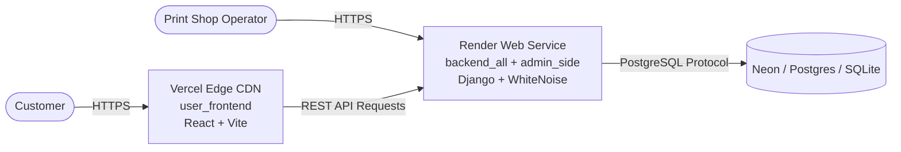

# 🚀 PrintX Free Cloud Deployment Guide (Vercel + Render)

This guide walks you through deploying **PrintX (printex.pk)** completely free using:
- **Frontend (`user_frontend`)**: Hosted on **[Vercel](https://vercel.com)** (Global Edge CDN, auto-SSL, instant builds).
- **Backend (`backend_all` + `admin_side`)**: Hosted on **[Render](https://render.com)** (Free Linux Web Service with Python 3.12, Gunicorn, WhiteNoise).
- **Database (Optional)**: Free PostgreSQL on **[Neon.tech](https://neon.tech)** (free forever, 0.5 GB) or SQLite default.

---

## 🏗️ Architecture Overview



---

## 📋 Prerequisites

1. A **[GitHub](https://github.com)** account with your PrintX repository pushed.
2. A free **[Render.com](https://render.com)** account.
3. A free **[Vercel.com](https://vercel.com)** account.

---

## 1️⃣ STEP 1: Deploy Backend on Render

You can deploy on Render either via **Render Blueprint** (automatic) or **Manual Web Service**.

### Option A: Automatic via Blueprint (`render.yaml`)
1. Go to [dashboard.render.com](https://dashboard.render.com/).
2. Click **New +** -> **Blueprint**.
3. Connect your GitHub repository.
4. Render will automatically detect [`render.yaml`](file:///Users/alihassan/Documents/printx.pk/render.yaml) and configure the build command, start command, and health check.
5. Click **Apply**.

---

### Option B: Manual Web Service Setup
1. In Render Dashboard, click **New +** -> **Web Service**.
2. Connect your PrintX repository.
3. Fill in the following settings:
   - **Name**: `printx-backend` (or your choice)
   - **Region**: Choose the closest region (e.g., Frankfurt or Oregon)
   - **Root Directory**: `backend_all`
   - **Runtime**: `Python 3`
   - **Build Command**: `./build.sh`
   - **Start Command**: `gunicorn config.wsgi:application --bind 0.0.0.0:$PORT --workers 2 --threads 4`
   - **Instance Type**: `Free`
4. Expand **Advanced** -> **Add Environment Variables**:

| Variable | Value | Notes |
|---|---|---|
| `PYTHON_VERSION` | `3.12.8` | Recommended Python version |
| `DJANGO_DEBUG` | `False` | Production mode |
| `DJANGO_SECRET_KEY` | *(Click "Generate" or enter a secure random string)* | Encryption key |
| `CORS_ALLOW_ALL_ORIGINS` | `True` | Allows Vercel frontend to query the API |
| `DJANGO_ALLOWED_HOSTS` | `*` | Or your render URL |
| `DATABASE_URL` *(Optional)* | `postgresql://...` | Connection string from Neon.tech (if using PostgreSQL) |

5. Click **Create Web Service**.
6. Wait 2-3 minutes for the build to finish. Once live, copy your backend URL:
   `https://<your-app-name>.onrender.com`

### Verification Checklist:
- Open `https://<your-app-name>.onrender.com/api/v1/health/` -> Should return `{"status": "ok"}`
- Open `https://<your-app-name>.onrender.com/api/docs/` -> Swagger OpenAPI UI
- Open `https://<your-app-name>.onrender.com/admin-panel/login.html` -> Print Shop Admin Portal

### Create Superuser (Admin Login):
1. In your Render Dashboard, click on your service -> **Shell** tab.
2. Run:
   ```bash
   python manage.py createsuperuser
   ```
3. Enter username, email, and password. You can now log into both Django Admin (`/admin/`) and Admin Operations (`/admin-panel/login.html`)!

---

## 2️⃣ STEP 2: Deploy Frontend on Vercel

1. Go to [vercel.com/dashboard](https://vercel.com/dashboard).
2. Click **Add New...** -> **Project**.
3. Import your GitHub repository.
4. In the **Configure Project** screen:
   - **Project Name**: `printx` (or your preferred name)
   - **Framework Preset**: `Vite`
   - **Root Directory**: Click **Edit** and select **`user_frontend`** (Important!)
   - **Build Command**: `npm run build` (automatic)
   - **Output Directory**: `dist` (automatic)
5. Expand **Environment Variables** and add:

| Name | Value |
|---|---|
| `VITE_API_BASE_URL` | `https://<your-backend-app>.onrender.com/api/v1` |
| `VITE_MAX_FILE_SIZE_BYTES` | `52428800` |
| `VITE_MAX_FILES_COUNT` | `10` |

> ⚠️ **Note:** Ensure your `VITE_API_BASE_URL` contains `https://` and ends with `/api/v1` with **no trailing slash**!

6. Click **Deploy**.
7. In ~30 seconds, your site is live at `https://<your-project>.vercel.app`!

---

## 3️⃣ STEP 3: Setup Free Permanent Database (Recommended)

Render's free tier PostgreSQL expires after 30 days. To get a **free forever** PostgreSQL database:

1. Sign up for free at **[Neon.tech](https://neon.tech)**.
2. Create a project named `printx-db`.
3. In your Neon dashboard, copy the **Connection string** (starts with `postgresql://...`).
4. In your **Render Dashboard** -> Go to `printx-backend` -> **Environment**:
   - Add/Update `DATABASE_URL` with your Neon connection string.
   - Click **Save Changes**.
5. Render will automatically redeploy and run migrations against your Neon PostgreSQL database!

---

## 💡 Important Free-Tier Notes

1. **Render Free Tier Sleep**:
   - Render's free web services automatically sleep after 15 minutes of inactivity to save resources.
   - When a user visits after a sleep period, the first request takes ~30-45 seconds to spin up. Subsequent requests are instant.
   - You can use free pinging services (e.g. [UptimeRobot](https://uptimerobot.com) or [Cron-Job.org](https://cron-job.org)) to ping `/api/v1/health/` every 10 minutes to keep it warm if desired.

2. **File Storage**:
   - Free cloud hosting instances use ephemeral filesystems (temporary storage).
   - Uploaded customer documents remain available while the instance is awake.
   - For long-term production storage across restarts, configure an S3 bucket (or free Cloudflare R2 / Supabase Storage).
